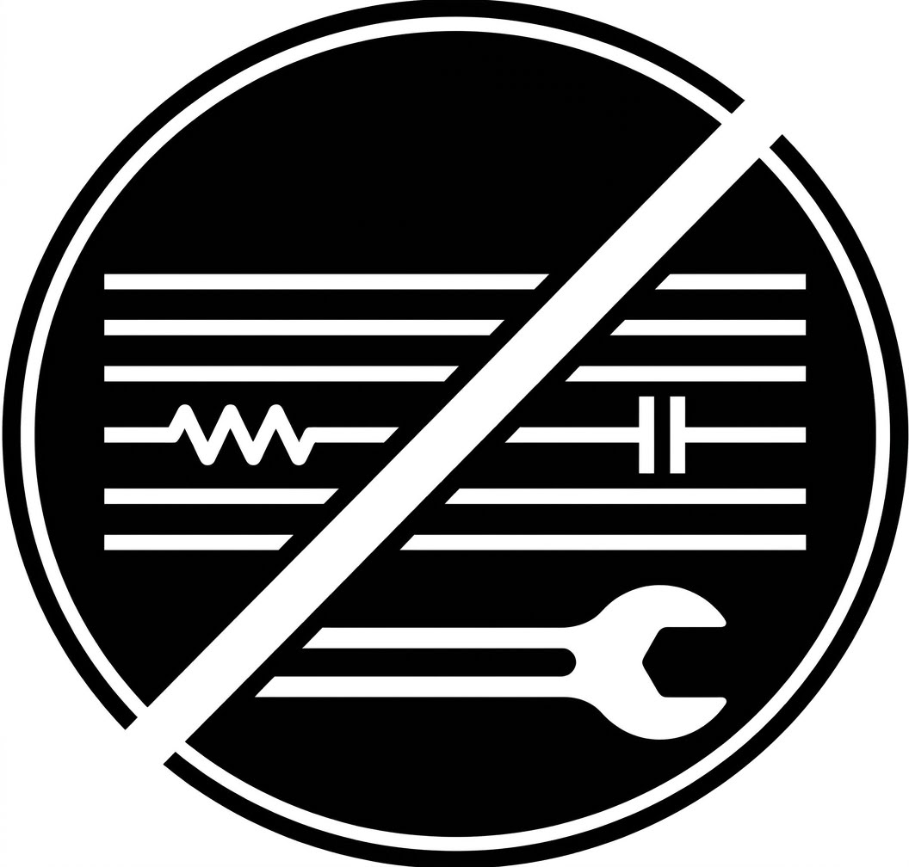
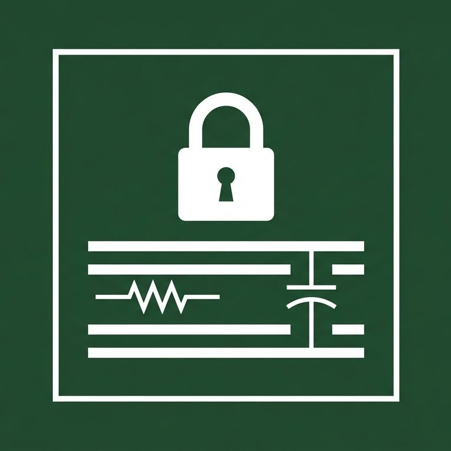

# 🛠️Global Visual Standard for Embedded PCB Components (Open-EPS) / Παγκόσμιο Οπτικό Σύμβολο Προειδοποίησης Ενσωματωμένων Εξαρτημάτων PCB

[English Version](#english-version) | [Ελληνική Έκδοση](#ελληνική-έκδοση)

---

## English Version

### Purpose & Usability (Abstract)
Due to the rapid advancement of Embedded Components technology, modern multi-layer PCBs now host resistors, capacitors, or integrated circuits inside their internal layers rather than just on the outer surface. 

When such a board malfunctions, the surface (top/bottom silkscreen) appears deceptively "empty." Technicians lose valuable time and often destroy the PCB by attempting impossible surgical repairs, unaware that the components are structurally buried. 

This Open-Source Icon was designed to be printed directly on the board's surface (silkscreen). It acts as a global, instant visual warning to technicians: "Do Not Attempt Repair - Non-Serviceable Material (Board Replacement Only)."

### Visual Variations

The project offers two alternative visual approaches for the designer to choose from:

#### 1. Version A (Minimalist Prohibition - Circular Shape)
  Elements: Horizontal layers, internal resistor and capacitor symbols, and a service wrench.
*   Message: A bold white diagonal line cuts through the service wrench, communicating that repair is prohibited while keeping the internal components visible.

#### 2. Version B (Locked Structure - Square Shape)
*   Elements: Horizontal layers, internal resistor and capacitor symbols, and a classic padlock at the top.
*   Message: Focuses on the concept of a "locked" and inaccessible internal architecture. The padlock warns that the layers are sealed and non-serviceable.

---

### AI Disclaimer
Design Note: The core concept, functionality, selection of electronic symbols, and structural variations belong entirely to the human creator. The visual execution, digitization, and production of the final graphic assets (icons) were developed with the assistance of Artificial Intelligence (AI-Generated Graphics), following precise and iterative design instructions (prompt engineering) to achieve the final industrial-grade result.

### License
Both versions of the symbol are distributed under the global Creative Commons Attribution-NoDerivatives 4.0 International License (CC BY-ND 4.0). 
*   Allowed: Free use, integration, and printing of the symbol on any commercial or open-source hardware project worldwide, without any cost or state fees.
*   Required: Attribution to the original creator.
*   Prohibited: Modification or alteration of the design elements, in order to maintain the uniformity of the symbol as a global, stable standard.

---

## Ελληνική Έκδοση

### Σκοπός & Χρηστικότητα (Abstract)
Λόγω της ραγδαίας εξέλιξης της τεχνολογίας Embedded Components (ενσωματωμένα εξαρτήματα), οι σύγχρονες πολυστρωματικές πλακέτες (multi-layer PCBs) φιλοξενούν πλέον αντιστάσεις, πυκνωτές ή ολοκληρωμένα κυκλώματα μέσα στα εσωτερικά τους στρώματα (internal layers) και όχι μόνο στην εξωτερική τους επιφάνεια. 

Όταν μια τέτοια πλακέτα παρουσιάζει βλάβη, η επιφάνειά της (silkscreen) φαίνεται απατηλά «άδεια», με αποτέλεσμα οι τεχνικοί να επιχειρούν αδύνατες χειρουργικές επεμβάσεις, καταστρέφοντας το PCB και χάνοντας πολύτιμο χρόνο. 

Το παρόν ανοιχτό σύμβολο (Open-Source Icon) σχεδιάστηκε για να τυπώνεται απευθείας στην επιφάνεια (silkscreen) της πλακέτας. Λειτουργεί ως μια διεθνής, άμεση οπτική προειδοποίηση προς τους τεχνικούς: «Μην επιχειρήσετε επισκευή - Μη επισκευάσιμο υλικό (Board Replacement Only)».

### Σχεδιαστικές Παραλλαγές

Το project προσφέρει δύο εναλλακτικές οπτικές προσεγγίσεις για να επιλέξει ο σχεδιαστής:

#### 1. Εκδοχή Α (Μινιμαλιστική Απαγόρευση - Κυκλικό Σχήμα)
  Στοιχεία: Οριζόντιες γραμμές (layers), εσωτερικά σύμβολα αντίστασης και πυκνωτή, και το γερμανικό κλειδί (service).
  Μήνυμα: Μια καθαρή, μακριά λευκή διαγώνια γραμμή τέμνει το σύμβολο του service, επικοινωνώντας ακαριαία την απαγόρευση επισκευής, αφήνοντας τα εξαρτήματα πεντακάθαρα.


#### 2. Εκδοχή Β (Κλειδωμένη Δομή - Τετράγωνο Σχήμα)
  Στοιχεία: Οριζόντιες γραμμές (layers), εσωτερικά σύμβολα αντίστασης και πυκνωτή, και ένα κλασικό λουκέτο στην κορυφή.
  Μήνυμα: Εστιάζει στην έννοια της «κλειδωμένης» και απροσπέλαστης αρχιτεκτονικής. Το λουκέτο προειδοποιεί ότι τα εσωτερικά στρώματα είναι σφραγισμένα και μη προσβάσιμα για συντήρηση.


---

### Δήλωση Χρήσης Τεχνητής Νοημοσύνης (AI Disclaimer)
Σημείωση Σχεδίασης: Η σύλληψη της ιδέας, η λειτουργικότητα, η επιλογή των ηλεκτρονικών συμβόλων και η δομή των παραλλαγών ανήκουν αποκλειστικά στον δημιουργό. Η οπτική υλοποίηση, η ψηφιοποίηση και η παραγωγή των τελικών γραφικών αρχείων (icons) πραγματοποιήθηκαν με τη συνδρομή εργαλείων Τεχνητής Νοημοσύνης (AI-Generated Graphics), ακολουθώντας ακριβείς και διαδοχικές σχεδιαστικές οδηγίες (prompt engineering) για την επίτευξη του τελικού βιομηχανικού αποτελέσματος.

### Άδεια Χρήσης (License)
Και οι δύο εκδοχές του συμβόλου διατίθενται υπό την παγκόσμια άδεια Creative Commons Attribution-NoDerivatives 4.0 International (CC BY-ND 4.0).
  Επιτρέπεται: Η ελεύθερη χρήση, ενσωμάτωση και εκτύπωση του συμβόλου σε οποιοδήποτε εμπορικό ή open-source hardware project παγκοσμίως, χωρίς κανένα κόστος ή παράβολο.
  Απαιτείται: Η αναφορά στο όνομα του δημιουργού.
  Απαγορεύεται: Η τροποποίηση ή αλλαγή των σχεδιαστικών στοιχείων, προκειμένου να διατηρηθεί η ομοιομορφία του συμβόλου ως παγκόσμιο σταθερό πρότυπο (standard).
