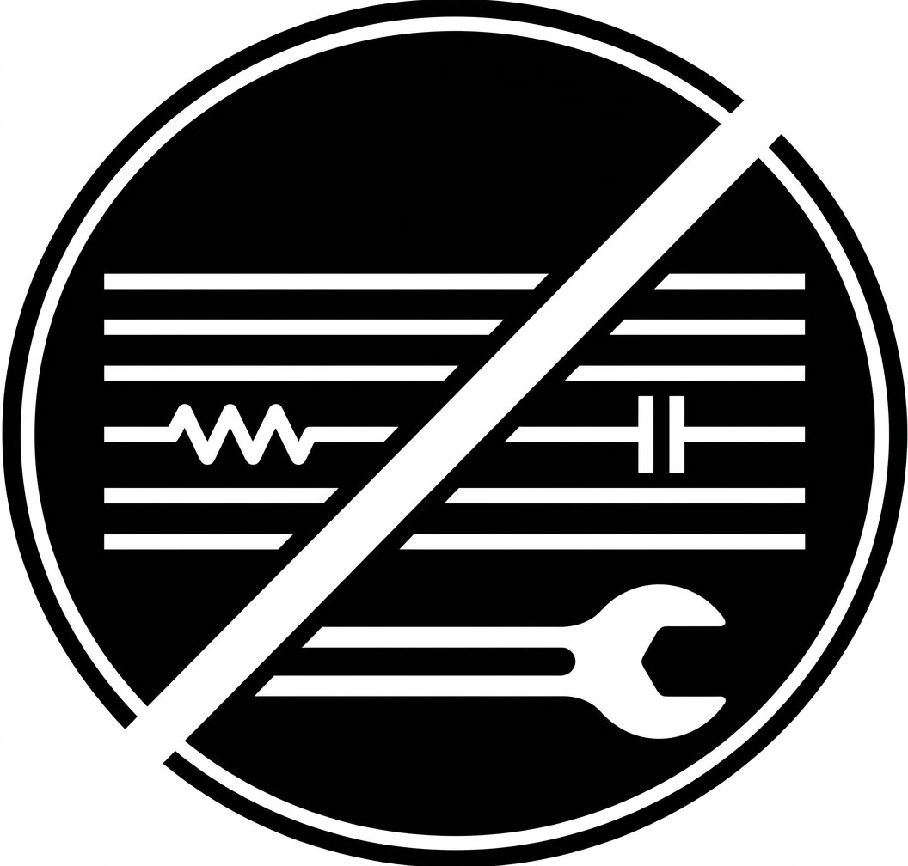
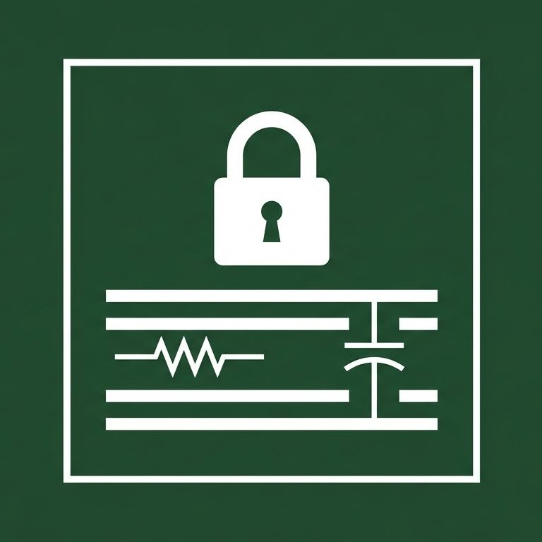

# Global Visual Standard for Embedded PCB Components (Open-EPS) / Παγκόσμιο Οπτικό Σύμβολο Προειδοποίησης Ενσωματωμένων Εξαρτημάτων PCB

[English Version](#english-version) | [Ελληνική Έκδοση](#ελληνική-έκδοση)

---

## English Version

### Purpose & Usability (Abstract)
Due to the rapid advancement of Embedded Components technology, modern multi-layer PCBs now host resistors, capacitors, or integrated circuits inside their internal layers rather than just on the outer surface. 

When such a board malfunctions, the surface (top/bottom silkscreen) appears deceptively "empty." Technicians lose valuable time and often destroy the PCB by attempting impossible surgical repairs, unaware that the components are structurally buried. 

This Open-Source Icon was designed to be printed directly on the board's surface (silkscreen). It acts as a global, instant visual warning to technicians: "Do Not Attempt Repair - Non-Serviceable Material (Board Replacement Only)."

### Visual Variations

The project offers two alternative visual approaches for the designer to choose from:

#### 1. Version A (Minimalist Prohibition - Circular Shape)
  Elements: Horizontal layers, internal resistor and capacitor symbols, and a service wrench.
*   Message: A bold white diagonal line cuts through the service wrench, communicating that repair is prohibited while keeping the internal components visible.

#### 2. Version B (Locked Structure - Square Shape)
*   Elements: Horizontal layers, internal resistor and capacitor symbols, and a classic padlock at the top.
*   Message: Focuses on the concept of a "locked" and inaccessible internal architecture. The padlock warns that the layers are sealed and non-serviceable.

---

### AI Disclaimer
Design Note: The core concept, functionality, selection of electronic symbols, and structural variations belong entirely to the human creator. The visual execution, digitization, the production of the final graphic assets (icons) and text writing were developed with the assistance of Artificial Intelligence, following precise and iterative design instructions (prompt engineering) to achieve the final result.

### Limitation of Liability / Disclaimer
This symbol is provided "as is", for informational and visual warning purposes only, without any express or implied warranty of any kind, including but not limited to warranties of fitness for a particular purpose or non-infringement. In no event shall the creator be liable for any claim, damages, PCB destruction, financial loss, or other liability arising from the use, printing, or reliance on this symbol. Technicians and manufacturers use it entirely at their own risk.

Both versions of the symbol are licensed under the Creative Commons Attribution-NoDerivatives 4.0 International (CC BY-ND 4.0) license, allowing free commercial and open-source use at no cost.

Color Exception:  
As an exception to the NoDerivatives (ND) restriction, modification of the symbol's colors is exclusively permitted (e.g., conversion to grayscale, monochrome for PCB/silkscreen printing, or adaptation to an application's color palette). Any other modification, distortion, alteration of proportions, or removal and addition of elements to the shape and structure of the symbol remains strictly prohibited, in order to maintain its uniformity as a universal fixed standard.

## Ελληνική Έκδοση

### Σκοπός & Χρηστικότητα (Abstract)
Λόγω της ραγδαίας εξέλιξης της τεχνολογίας Embedded Components (ενσωματωμένα εξαρτήματα), οι σύγχρονες πολυστρωματικές πλακέτες φιλοξενούν πλέον αντιστάσεις, πυκνωτές ή ολοκληρωμένα κυκλώματα μέσα στα εσωτερικά τους στρώματα και όχι μόνο στην εξωτερική τους επιφάνεια. 

Όταν μια τέτοια πλακέτα παρουσιάζει βλάβη, η επιφάνειά της φαίνεται απατηλά «άδεια», με αποτέλεσμα οι τεχνικοί να επιχειρούν αδύνατες χειρουργικές επεμβάσεις, καταστρέφοντας τη πλακέτα και χάνοντας πολύτιμο χρόνο. 

Το παρόν ανοιχτό σύμβολο (Open-Source Icon) σχεδιάστηκε για να τυπώνεται απευθείας στην επιφάνεια (στρώματα) της πλακέτας. Λειτουργεί ως μια διεθνής, άμεση οπτική προειδοποίηση προς τους τεχνικούς: «Μην επιχειρήσετε επισκευή - Μη επισκευάσιμο υλικό (Board Replacement Only)».

### Σχεδιαστικές Παραλλαγές

Το έργο προσφέρει δύο εναλλακτικές οπτικές προσεγγίσεις για να επιλέξει ο σχεδιαστής:

#### 1. Εκδοχή Α (Μινιμαλιστική Απαγόρευση - Κυκλικό Σχήμα)
  Στοιχεία: Οριζόντιες γραμμές (στρώματα), εσωτερικά σύμβολα αντίστασης και πυκνωτή, και το γερμανικό κλειδί (επισκευή).
  Μήνυμα: Μια καθαρή, μακριά λευκή διαγώνια γραμμή τέμνει το σύμβολο της επισκευής, επικοινωνώντας ακαριαία την απαγόρευση επισκευής, αφήνοντας τα εξαρτήματα πεντακάθαρα.


#### 2. Εκδοχή Β (Κλειδωμένη Δομή - Τετράγωνο Σχήμα)
  Στοιχεία: Οριζόντιες γραμμές (στρώματα), εσωτερικά σύμβολα αντίστασης και πυκνωτή, και ένα κλασικό λουκέτο στην κορυφή.
  Μήνυμα: Εστιάζει στην έννοια της «κλειδωμένης» και απροσπέλαστης αρχιτεκτονικής. Το λουκέτο προειδοποιεί ότι τα εσωτερικά στρώματα είναι σφραγισμένα και μη προσβάσιμα για συντήρηση.


---

### Δήλωση Χρήσης Τεχνητής Νοημοσύνης (AI Disclaimer)
Σημείωση Σχεδίασης: Η σύλληψη της ιδέας, η λειτουργικότητα, η επιλογή των ηλεκτρονικών συμβόλων και η δομή των παραλλαγών ανήκουν αποκλειστικά στον δημιουργό. Η οπτική υλοποίηση, η ψηφιοποίηση, η παραγωγή των τελικών γραφικών αρχείων (εικονίδια) και κειμένων πραγματοποιήθηκαν με τη συνδρομή εργαλείων Τεχνητής Νοημοσύνης, ακολουθώντας ακριβείς και διαδοχικές σχεδιαστικές οδηγίες για την επίτευξη του τελικού αποτελέσματος.

### Περιορισμός Ευθύνης / Αποποίηση
Το παρόν σύμβολο παρέχεται «ως έχει», αποκλειστικά για σκοπούς ενημέρωσης και οπτικής προειδοποίησης, χωρίς καμία ρητή ή σιωπηρή εγγύηση οποιουδήποτε είδους (καταλληλότητας, ορθότητας ή μη παραβίασης). Σε καμία περίπτωση ο δημιουργός δεν φέρει ευθύνη για οποιαδήποτε αξίωση, ζημία, καταστροφή υλικού (πλακέτα), οικονομική απώλεια ή άλλη ευθύνη που προκύπτει από τη χρήση, την εκτύπωση ή την εμπιστοσύνη σε αυτό το σύμβολο. Οι τεχνικοί και οι κατασκευαστές το χρησιμοποιούν αποκλειστικά με δική τους ευθύνη.

### Άδεια Χρήσης (License)

Και οι δύο εκδοχές του συμβόλου διατίθενται υπό την παγκόσμια άδεια Creative Commons Attribution-NoDerivatives 4.0 International (CC BY-ND 4.0), επιτρέποντας την ελεύθερη εμπορική και open-source χρήση τους χωρίς κανένα κόστος.
Εξαίρεση Χρώματος:  
Κατ' εξαίρεση των περιορισμών της άδειας ND (Όχι Παράγωγα), επιτρέπεται αποκλειστικά η αλλαγή των χρωμάτων του συμβόλου (π.χ. μετατροπή σε ασπρόμαυρο, μονόχρωμο για εκτύπωση σε πλακέτες/μεταξοτυπία ή προσαρμογή στη χρωματική παλέτα μιας εφαρμογής). Οποιαδήποτε άλλη τροποποίηση, παραμόρφωση, αλλαγή στις αναλογίες, αφαίρεση ή προσθήκη στοιχείων στο σχήμα και τη δομή του συμβόλου απαγορεύεται αυστηρά, προκειμένου να διατηρηθεί η ομοιομορφία του ως παγκόσμιο σταθερό πρότυπο.
